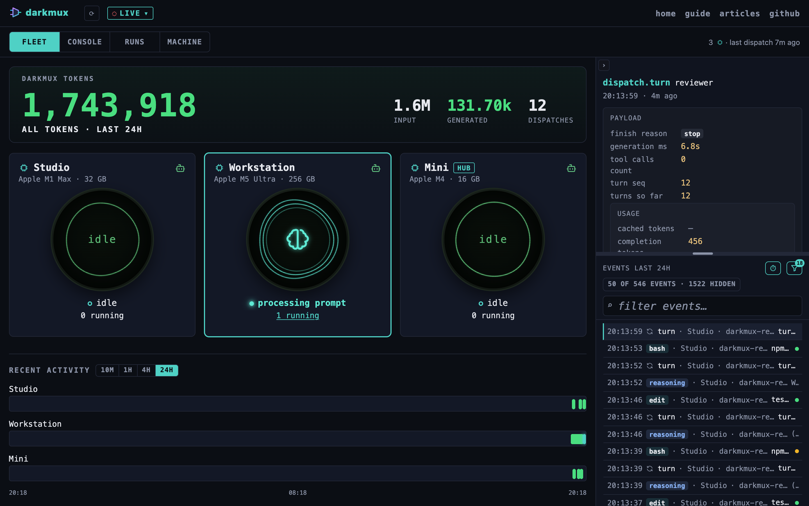

# darkmux

[](https://github.com/kstrat2001/darkmux/actions/workflows/ci.yml)
[](https://github.com/kstrat2001/darkmux/releases)
[](https://github.com/kstrat2001/darkmux/actions/workflows/quality.yml)
[](LICENSE)

**Own your AI workforce.** Run real engineering work on models you already have, on machines you already own.

darkmux turns a Mac (or a few of them on a tailnet) into a working local-AI fleet: config-defined **missions** run as live task graphs by a crew of role-staffed models. Every consequential step gates on your sign-off. Every dispatch leaves a record: which machine, which model, and why. Underneath it, a **lab** that measures what your hardware actually does, so your configuration rests on numbers, not vibes.

**[darkmux.com](https://darkmux.com) · [Live demo](https://darkmux.com/demo) — watch a real mission replay in your browser. Nothing to install.**

> **Read before running.** darkmux orchestrates AI tools that execute on your machine. It drives the model servers on your machine (LM Studio, Tensorfold, rec's Flint, or one you run) and, in lab mode, runs AI-generated code in a working directory that is **not a security sandbox**. AI agents can behave unexpectedly; use darkmux on a machine where that is acceptable. Performance numbers here and in the articles were measured on the author's hardware and will differ on yours. See [DISCLAIMER.md](./DISCLAIMER.md). MIT licensed, no warranty.

## Install

```bash
brew tap kstrat2001/tap
brew install darkmux

darkmux init      # config + profiles + agent skills (never overwrites)
darkmux doctor    # pre-flight: engines, models, sandbox, runtime, RAM
```

You need one engine with one model: a local server or a hosted seat (next section). `darkmux init` finds the engines already installed on the machine and lists them. Dispatches run in the operating system's own sandbox, with nothing to install: Seatbelt on a Mac, Landlock on Linux where the kernel supports it, else Docker. [Docker](https://www.docker.com/products/docker-desktop) is optional everywhere (`darkmux config set runtime.sandbox docker`); under it the runtime image pulls from GHCR on first use. Building from source, hub setup, updating, configuration: [docs/OPERATIONS.md](docs/OPERATIONS.md) · [full guide](https://darkmux.com/guide/).

## Where the models run

Every role in your profile registry names where its model runs, so one machine can mix engines, and one fleet can mix machines:

| Engine | What darkmux does with it |
|---|---|
| [LM Studio](https://lmstudio.ai/) | Loads and unloads models at the context each profile declares, under the machine's memory budget, and starts LM Studio's local server when it is off. |
| [Tensorfold](https://tensorfold.dev/), Flint (by [Recursive](https://recursive.com/)) | Starts and stops the server itself, on the port the profile names. `darkmux init --add-engine flint` (or `tensorfold`) adds one with a profile running its model. |
| Any OpenAI-compatible server you run, such as `mlx_lm.server` | Sends it work. `darkmux init --engine-url <url>` records it as the machine's engine, so a machine without LM Studio runs `init` and dispatch with no hand-edited config. |
| A hosted OpenAI-compatible endpoint | Staffs any seat with cloud weights. |
| Claude (the Messages API) | Staffs any seat, with prompt caching on every turn ([guide](https://darkmux.com/guide/claude.html)). |

A machine with no local models still runs full reviews on hosted seats. `darkmux doctor` checks that the machine's engine answers and names any installed engine not yet configured. Design and status: [docs/architecture/ENGINES.md](docs/architecture/ENGINES.md).

## Your first mission

```bash
darkmux profile scan                  # match your downloaded models into profiles
darkmux lab characterize              # "QA my Mac": smoke workload in, verdict out
darkmux dispatch coder "add a smoke test for src/lib.rs"
darkmux radio "review this branch"    # its committed changes, reviewed by a local crew (asks first)
darkmux serve                         # live fleet view at http://localhost:8765
```

Every mission runs as a live task graph you can watch from any device on your tailnet, including your phone.



## What you get

- 🎯 **Missions, not chat.** Define work as config, launch it with one verb, watch it run as a task graph. Consequential steps stop and wait for your sign-off.
- 🤝 **A crew, not a model.** Roles (coder, reviewer, judge, crawler), each staffed by the model that fits it: on LM Studio, Tensorfold, Flint or a server you run, or a hosted endpoint when a seat needs frontier weights. Your registry, your call.
- 🔍 **PR review by local models.** `mission launch review` bundles the change, fans probe seats across it, double-confirms every finding with an independent judge, and posts an anchored review. darkmux [reviews its own PRs in public](.github/workflows/darkmux-review.yml) this way.
- 🧪 **The lab.** `darkmux lab run <workload>` captures wall clock, trajectory, and verify outcome on *your* hardware: baseline, change one knob, measure again. The [published findings](https://darklyenergized.substack.com) are re-runnable claims, not anecdotes.
- 📊 **A fleet you can see.** One live view across every machine: what's loaded, what's running, and how many tokens each endpoint and model used. Phone-ready over your tailnet.
- 🔒 **Provenance by default.** Every dispatch emits a structured record (machine, model, role, mission). Opt-in BLAKE3 hash-chained audit log with edit detection, cron-friendly (`flow integrity-check` exits 2 on a chain break, 3 when the trail is incomplete).
- 🖥️ **Editor-embedded**: darkmux as a Zed agent over ACP: `/mission launch review` from the panel, sign-off dialogs in the editor, and RADIO, the free-text voice on the console.

## What darkmux is for

The north star, in five claims:

1. **Optimization, not replacement.** Local models make your frontier assistant *better* by taking the work it shouldn't be burning budget on. Complementary teammates, not substitutes.
2. **Harness, then model.** Most "the model is bad" problems are harness problems. The same 35B on the same Mac ranged 25 minutes to 5 on one workload depending on configuration. Fix the harness first; darkmux is the harness.
3. **The lab and the loop.** Baseline → single-variable change → re-measure → record. Tuning discipline is the product, not a nice-to-have.
4. **Team integrity.** A fleet of identical 35B reasoners is not a team. darkmux keeps utility seats and specialist seats composed as models and hardware change.
5. **The recursive test.** A fresh session, given a clean install and these docs, should reach these same conclusions. If it can't, the docs have drifted — and that's a bug.

## The proof

darkmux exists because the [Genesis series](https://darklyenergized.substack.com) measured its way to it, in public:

- **[Genesis I](https://darklyenergized.substack.com/p/can-a-35b-local-model-write-your):** *Can a 35B local model write your unit tests?* Sweep the field, keep what works.
- **[Genesis II](https://darklyenergized.substack.com/p/part-2-charting-the-wake):** *Charting the Wake.* Configuration drift around the model matters more than the model.
- **[Genesis III](https://darklyenergized.substack.com/p/darkmux-genesis-iii-hybrid-by-design):** *Hybrid by Design.* What the operator–orchestrator–local-stack continuum looks like once it survives contact with real work.

## Honest limits

- **Managed engines: LM Studio, Tensorfold and rec's Flint.** darkmux loads, starts, stops and budgets memory for those three. Any other OpenAI-compatible local server runs work as an endpoint (verified on `mlx_lm.server`), but darkmux does not load models on it or count what it holds against the machine's memory; Ollama and llama.cpp have no dedicated backend ([#316](https://github.com/kstrat2001/darkmux/issues/316)).
- **Developed and dogfooded on Apple Silicon.** Linux compiles and passes CI's fleet tests, but nobody dogfoods it yet; Intel Mac is untested.
- **Built to be driven by a frontier orchestrator** (Claude Code or equivalent). Standalone CLI use works for scripting; orchestrator-driven is the design.
- **One operator, their own machines.** Not team tooling, not multi-tenant: a few Macs on a tailnet you trust. That's a focus, not a fence.

## Status

**v5.12.0** on the [Homebrew tap](https://github.com/kstrat2001/homebrew-tap), moving fast: breaking changes ship clean with migration notes, and every release is dogfooded on real work before it tags. Full history: [CHANGELOG.md](CHANGELOG.md).

## Security

Single-operator, local-first. Keep `darkmux serve` on loopback and treat AI-generated code like any untrusted script. Threat model and private reporting: [SECURITY.md](./SECURITY.md).

## License

MIT · Kain Osterholt · [@DarklyEnergized](https://x.com/DarklyEnergized) · Darkly Energized LLC

---

*Claude and Claude Code are trademarks of Anthropic PBC. LM Studio is a trademark of Element Labs Inc. darkmux is affiliated with neither.*
